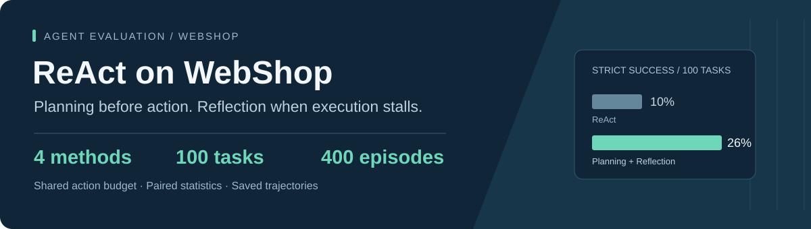
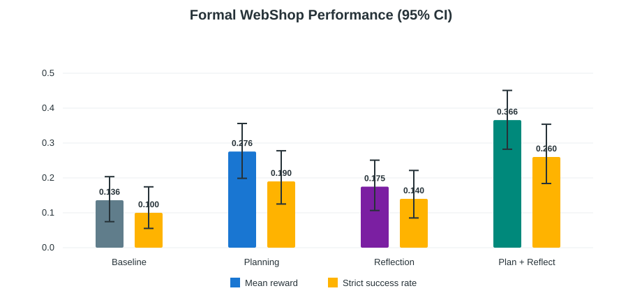
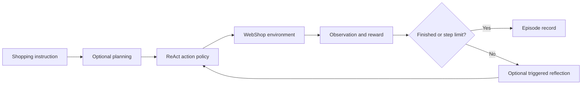

<p align="center">
  
</p>

<p align="center">
  <b>Four agent variants. The same 100 shopping tasks. Paired evaluation.</b><br>
  <a href="README.zh-CN.md">中文</a> ·
  <a href="#results">Results</a> ·
  <a href="#quick-start">Quick start</a> ·
  <a href="docs/ARCHITECTURE.md">Architecture</a> ·
  <a href="docs/REPRODUCIBILITY.md">Reproducibility</a>
</p>

This repository compares two additions to a ReAct shopping agent: a plan before the first action, and bounded reflection when execution stalls. It includes the implementation, prompts, configurations, 400 recorded episodes, and paired statistical analysis.

The combined variant reached **26% strict success**, compared with **10% for ReAct**, on this task set. It used fewer environment steps but had higher wall-clock latency. These are recorded experiment results, not a claim of general benchmark superiority.

## Results

Each variant was evaluated once on `fixed_10`–`fixed_109` using the full WebShop dataset. Reward is the environment score; strict success means `reward == 1.0`.

| Method | Mean reward | Strict success | Mean steps | Mean model calls |
|:--|--:|--:|--:|--:|
| ReAct | 0.1360 | 10 / 100 | 13.95 | 13.95 |
| + Planning | 0.2755 | 19 / 100 | 12.29 | 13.29 |
| + Reflection | 0.1750 | 14 / 100 | 13.77 | 15.52 |
| **+ Planning & Reflection** | **0.3658** | **26 / 100** | **11.52** | **13.82** |



The combined variant's paired reward gain over ReAct is **+0.230**, with a 95% bootstrap interval of **[+0.136, +0.327]**. The planning × reflection interaction interval crosses zero; the evidence does not establish statistical synergy.

[Statistical report](results/formal/analysis/REPORT.md) · [Metrics CSV](results/formal/analysis/formal_metrics.csv) · [Raw episodes](results/formal) · [Experiment protocol](EXPERIMENTS.md)

## Method

All variants share the same environment adapter, action loop, model settings, demonstrations, and 15-step budget. Planning adds one model call. Reflection adds at most two calls, triggered by an invalid action, an immediately repeated action, or unfinished execution at the configured midpoint.



Auxiliary calls are counted separately from environment steps. See [architecture](docs/ARCHITECTURE.md) for the module map and trigger rules.

## Quick start

### Inspect the saved results — no API key needed

```bash
git clone https://github.com/qihua728/react-webshop-planning-reflection.git
cd react-webshop-planning-reflection
python scripts/verify_results.py
```

The verifier uses only the Python standard library. It checks paired tasks and saved summary metrics without modifying the records. To regenerate confidence intervals, tables, and SVG figures:

```bash
python analysis/analyze_formal.py
```

The analysis uses 20,000 bootstrap samples and 100,000 randomization samples, so it takes longer than the verifier and rewrites `results/formal/analysis/`.

### Install and test

Python **3.10+** is required. Run these commands from the repository root:

```bash
python -m venv .venv
# Windows PowerShell
.venv\Scripts\python.exe -m pip install -e .
.venv\Scripts\python.exe -m unittest discover -s tests -v
```

On Linux/macOS, use `.venv/bin/python` instead. The existing **18 unit tests passed locally** during repository preparation. The included CI workflow runs tests and result verification; it never calls the model API.

### Run a new episode

Live runs require a separately deployed WebShop service, its data and search index, and a DeepSeek API key. Full-environment setup is **not yet self-contained**: the historical `full-streaming-ijson-v1` patch is referenced by metadata but is absent from this repository. Review [reproduction requirements](docs/REPRODUCIBILITY.md) first.

With a working service at `http://localhost:3000`:

```powershell
$env:DEEPSEEK_API_KEY="your-api-key"
.venv\Scripts\python.exe -m webshop_baseline --config configs/baseline_frozen.yaml check-env --task-id fixed_0
.venv\Scripts\python.exe -m webshop_baseline --config configs/baseline_frozen.yaml run --start 0 --count 1
```

`check-env` fetches a page without calling the model. `run` uses a paid API. The development config writes outside the saved formal results. Keep `results/formal/` unchanged when comparing against this release; use separate output paths for new formal runs.

## Repository map

| Path | Contents |
|:--|:--|
| [`src/webshop_baseline/`](src/webshop_baseline) | Agent loop, environment adapter, model client, runner, evaluation |
| [`configs/`](configs) · [`prompts/`](prompts) | Development/formal settings and action/auxiliary prompts |
| [`results/formal/`](results/formal) | 400 saved episodes, summaries, analysis tables and figures |
| [`analysis/`](analysis) | Paired statistics and SVG generation |
| [`paper/`](paper) | Technical report source, bibliography and figures |
| [`tests/`](tests) · [`scripts/`](scripts) | Unit tests, offline verifier and interleaved runner |

## Scope and limitations

- One run per method and task; no multi-seed estimate of model variability.
- Task pairing controls the task set, not all sources of API or service variation.
- Lower step counts do not imply lower latency or token cost. The combined variant's mean episode latency was 115.57 s versus 67.72 s for ReAct.
- Reflection alone has a paired reward interval that includes zero.
- Local tests and offline record checks do not validate a fresh live deployment.

## References

- [ReAct](https://github.com/ysymyth/ReAct): reasoning and acting framework and demonstrations.
- [WebShop](https://github.com/princeton-nlp/WebShop): interactive shopping environment and benchmark.
- [Technical report source](paper/main.tex) and [bibliography](paper/references.bib).

Upstream template attribution is retained. An open-source license has not yet been selected for the original project files; this repository does not grant new rights over upstream code, templates, or benchmark data.
