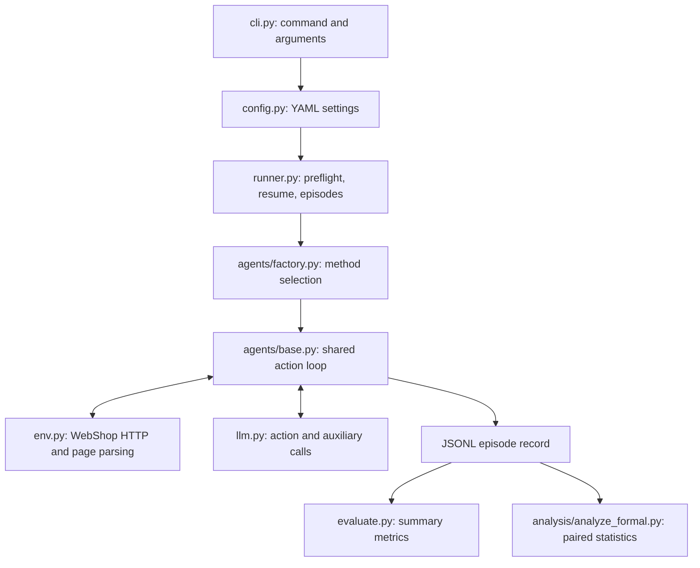

# Architecture

The four agents differ through two hooks in a shared loop. Environment navigation, action parsing, model calls and result writing are kept in common modules so that the ablation changes are easy to locate.

## Execution path

| Module | Responsibility |
|:--|:--|
| `cli.py` | `check-env`, `run` and `evaluate` commands |
| `config.py` | Typed settings and repository-relative file resolution |
| `env.py` | HTTP requests, page observations, action validation and reward extraction |
| `llm.py` | OpenAI-compatible DeepSeek requests and usage counters |
| `agents/base.py` | Prompt construction, action loop, optional planning and reflection |
| `agents/{baseline,planning,reflection,full}.py` | Enable the two hooks for each variant |
| `runner.py` | Environment preflight, task selection, resume and JSONL persistence |
| `evaluate.py` | Episode summaries and auxiliary-format error metrics |

## Planning and reflection

Planning runs once after reset and before the first action. Its output remains in the action context alongside the task instruction. Reflection uses the instruction, the plan if present, and at most five recent steps by default.

Reflection is eligible when any of these conditions holds:

1. The preceding action was invalid.
2. The last two actions are identical.
3. The configured midpoint has been reached without completion; this midpoint trigger fires once.

The default formal settings cap reflection at two calls and set the midpoint to eight steps. Auxiliary output format validity is recorded. A malformed auxiliary output is not silently counted as a valid one.

## Episode record

Each row contains task/method identifiers, reward, success, termination status, trajectory, planning/reflection output, usage counters, prompt/data versions and a recording timestamp. `steps` counts action-policy calls, including `think[...]`; `total_llm_calls` also includes planning and reflection.

Resume skips a task already recorded with `completed` or `max_steps` status. An episode ending after a purchase is not necessarily a strict success: strict success requires full reward. See `EXPERIMENTS.md` for the formal comparison protocol.

## Boundaries

The WebShop server, search index, dataset and model API are external dependencies. Unit tests replace these dependencies with fixtures/mocks; they validate local behavior rather than live service compatibility. The offline result verifier checks the saved dataset independently of those services.
