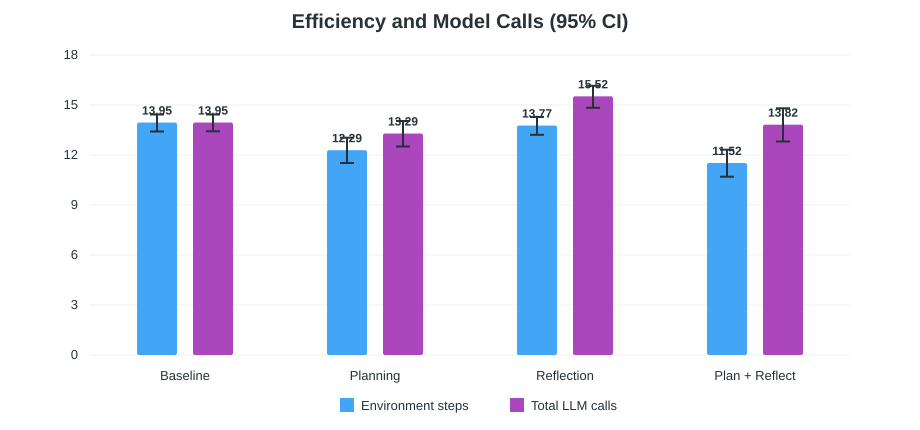

# WebShop 正式实验统计报告

生成参数：随机种子 `20260801`，bootstrap `20,000` 次，配对随机化检验 `100,000` 次。

## 数据完整性

- 四组各 100 个唯一任务，共 400 条有效结果；配对任务数为 100。
- 正式任务范围为 `fixed_10`–`fixed_109`，全部使用 `dataset_mode=full`。
- 无缺失任务、无重复有效记录、无 WebShop 环境错误，完整性检查通过。

## 主要结果

| 方法 | 平均奖励（95% CI） | 严格成功率（95% CI） | 平均步数 | 平均 LLM 调用 | 非法动作率 | 达到步数上限 |
|---|---:|---:|---:|---:|---:|---:|
| Baseline | 0.136 [0.075, 0.204] | 10% [5.5%, 17.4%] | 13.95 | 13.95 | 7.2% | 84% |
| Planning | 0.276 [0.199, 0.356] | 19% [12.5%, 27.8%] | 12.29 | 13.29 | 10.8% | 63% |
| Reflection | 0.175 [0.107, 0.251] | 14% [8.5%, 22.1%] | 13.77 | 15.52 | 8.1% | 80% |
| Plan + Reflect | 0.366 [0.282, 0.451] | 26% [18.4%, 35.4%] | 11.52 | 13.82 | 7.8% | 53% |

## 与 Baseline 的配对比较

奖励差使用任务级配对 bootstrap 置信区间和配对符号翻转随机化检验；成功差使用 McNemar 精确检验。两类检验分别对三次 Baseline 比较进行 Holm 校正。

| 比较 | 平均奖励差（95% CI） | 奖励 Holm p | Baseline独有/方法独有成功 | McNemar Holm p | 步数中位差 | LLM调用均值差 |
|---|---:|---:|---:|---:|---:|---:|
| Planning vs Baseline | +0.139 [+0.047, +0.231] | 0.0074 | 5/14 | 0.1271 | +0.0 | -0.66 |
| Reflection vs Baseline | +0.039 [-0.035, +0.115] | 0.3320 | 4/8 | 0.3877 | +0.0 | +1.57 |
| Plan + Reflect vs Baseline | +0.230 [+0.136, +0.327] | 0.0001 | 4/20 | 0.0046 | +0.0 | -0.13 |

## 2×2 消融效应

| 效应 | 奖励估计 | 95% CI |
|---|---:|---:|
| Planning main effect | +0.165 | [+0.091, +0.238] |
| Reflection main effect | +0.065 | [+0.010, +0.120] |
| Planning x Reflection interaction | +0.051 | [-0.059, +0.162] |

## 结论

- `Plan + Reflect` 的平均奖励最高（0.366），严格成功率为 26%。
- 完整方法相对 Baseline 的平均奖励提高 +0.230，其 95% CI 为 [+0.136, +0.327]。
- 完整方法把平均环境步数从 13.95 降至 11.52；但 Planning 与 Reflection 属于额外模型调用，必须结合 `mean_llm_calls` 和 token 指标讨论成本。
- Reflection 单独使用时提升较小，并产生 16 次辅助输出格式错误；完整方法仅有 3 次，提示 Planning 上下文可能让反思输出更稳定。这是结果关联，不能直接当作机制因果证明。
- 单次 100 任务实验的置信区间仍较宽；结论应以效应量和区间为主，不应只依赖 p 值。

## 文件说明

- `formal_metrics.csv`：四组点估计、置信区间、效率和格式指标。
- `paired_comparisons.csv`：三组相对 Baseline 的配对效应和检验。
- `factorial_effects.csv`：Planning、Reflection 主效应与交互效应。
- `integrity_report.json`：原始结果完整性审计。
- `method_performance.svg`、`efficiency.svg`：论文可直接引用的矢量图。
